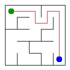

# Assignment 3. Maze Escape

Student ID: 252673
Name: Magzhan Assankhan
Group: SE-2512
Maze size (rows x columns): 9 x 10

## Program output

Results from `java -cp out Main`:

```text
Broken: 89
Kept: 72
Last broken wall: 125
MST cost: 27166
Heaviest broken wall: 789
Path length: 25
DFS visited: 72
Dead ends: 28
Zones: 10
Largest zone: 15
Is DAG: 0
Flow stages: 7
Fastest route cost: 5
```

## My maze



Open `output/maze.html` in a browser to explore the maze.

## Questions

### Mission 0

`find` returns the root of the group containing a cell. `union` joins two different groups and returns false if they are already connected. Union by size attaches the smaller tree to the larger one, and path compression shortens the links to the root.

### Mission 1

There are R*C separate groups at the start, and each broken wall reduces the number of groups by one, so connecting all cells requires R*C - 1 broken walls. The grid has R*(C-1) + C*(R-1) inner walls; subtracting the broken walls gives (R-1)*(C-1) kept walls. My maze has 90 cells, so 89 walls are broken and 72 remain.

### Mission 2

Kruskal and Prim both gave an MST cost of 27166. Both algorithms find a minimum spanning tree, which connects all cells with the lowest total wall-breaking cost. All wall costs are different in this assignment, so the minimum spanning tree is unique.

### Mission 3

The maze is connected and has no cycles, so it is a tree. A tree has exactly one simple path between any two cells. My DFS uses an array as an explicit stack instead of recursive calls, avoiding a recursion stack overflow on large mazes.

### Mission 4

The first DFS records the finishing order, and the second DFS processes cells in reverse finishing order on the reversed graph. Reversing the edges preserves each strongly connected component, and this order prevents the second DFS from entering another unassigned component. Since self-loops are not allowed, the graph has no directed cycle exactly when every cell forms its own component.

### Mission 5

The zone numbers are in topological order, so every edge between different zones goes from a smaller number to a larger number. This means all incoming updates to a zone are ready before it is processed, allowing the longest chain and cheapest route to be calculated in one forward pass. With Z zones and E edges between zones, this pass takes O(Z + E) time; building the zone graph takes expected O(n + m) time using hash maps.

## AI use

I used ChatGPT to explain the assignment and algorithms step by step, generate implementation code and additional DSU tests, and help draft the README answers and complexity table. It also helped me run the checks and interpret the program output and timing results.

## Testing

I ran `java tools/Check.java`. All DSU checks passed, and all 13 output lines matched the expected results for the tiny, small and dag examples.

I also ran the program on my personal data generated from student ID 252673. The browser page showed that I reached the exit in 25 moves, matching the program's path length.

## Timing (Mission 7)

Average time in milliseconds over 5 runs, measured with `java -cp out Bench`.

| Maze | Kruskal | Prim |
|---|---|---|
| 100 x 100 | 17 ms | 9 ms |
| 300 x 300 | 72 ms | 73 ms |
| 1000 x 1000 | 1237 ms | 2061 ms |

Both algorithms took more time as the maze size increased. Prim was faster on the smallest maze, while their times were almost equal on the medium maze. Kruskal was faster on the largest maze in my measurements.

## Complexity

n is the number of cells, and m is the number of walls or slides.
Space means additional memory used by the implementation.

| Algorithm | Time | Space | Assumptions |
|---|---|---|---|
| DSU find and union | O(alpha(n)) amortized per operation | O(n) for the DSU | Union by size and path compression; initialization takes O(n) |
| Build maze in file order | O(n + m * alpha(n)) amortized | O(n) | Each wall is checked once |
| Kruskal | O(n + m log m) | O(n + m) | Sorting wall indexes and using DSU |
| Prim | O(n + m log m) | O(n + m) | Adjacency lists and a priority queue containing wall indexes |
| DFS | O(n + m) | O(n + m) | Explicit stack and adjacency lists; in the maze m = n - 1 |
| Kosaraju | O(n + m) | O(n + m) | Two iterative DFS passes and forward/reversed adjacency lists |
| Route in the zone graph | O(n + m) expected overall | O(n + m) | Expected constant-time hash map operations; topological pass takes O(Z + E) |

alpha(n) is the inverse Ackermann function, which grows extremely slowly.
Z is the number of zones, and E is the number of distinct edges between zones.

## Run

Generate personal input files:

```bash
java tools/MakeVariant.java 252673 data
```

Compile and run:

```bash
javac -d out src/*.java
java -cp out Main
```

Run the checks:

```bash
java tools/Check.java
```

Run the benchmark:

```bash
java -cp out Bench
```

## Submission checklist

- [ ] All source files are included.
- [ ] data/walls.txt and data/slides.txt are included.
- [ ] output/maze.png is included.
